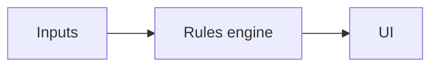

# Technical spec: <project name>

Version: v0.1 · Satisfies: docs/REQUIREMENTS.md v0.1 · Owner: architect agent + engineers

> HOW we build it. Each section lists the requirement IDs it satisfies. Keep it short.

## 1. Architecture (satisfies: …)
- Stack: <frontend / backend / storage>, and why (48 h, offline-first, team skills)
- Diagram (Mermaid):

## 2. Data (satisfies: DR-…)
| Entity | Fields (name: type, unit) | Source dataset (name, ID, link) | Real / SYNTHETIC |
|--------|---------------------------|---------------------------------|------------------|

## 3. Rules engine contract (satisfies: SR-…)
- Rules live in a reviewed file (`rules/*.yaml|json`), not in code or in a model prompt.
- Each rule: id, input(s), condition, output tier, advice card id, source citation, evidence grade, hazard log ref.
- LLMs may explain or summarise; they never decide tiers or change steps.

## 4. Interfaces (satisfies: …)
| Interface | Request | Response | Mocked until |
|-----------|---------|----------|--------------|

## 5. UI screens (satisfies: …)
| Screen | User | Shows | Requirement IDs | Demo step |
|--------|------|-------|-----------------|-----------|

## 6. Fallbacks and offline (satisfies: NFR-…)
- No network: …  · Voice fails: typed input  · Live demo fails: recorded footage

## 7. Labelling, citation and units
- SYNTHETIC label mechanism: …
- Units: one unit system per screen; units on every value.

## 8. Risks
| Risk | Likelihood | Impact | Mitigation | Owner |
|------|------------|--------|------------|-------|
