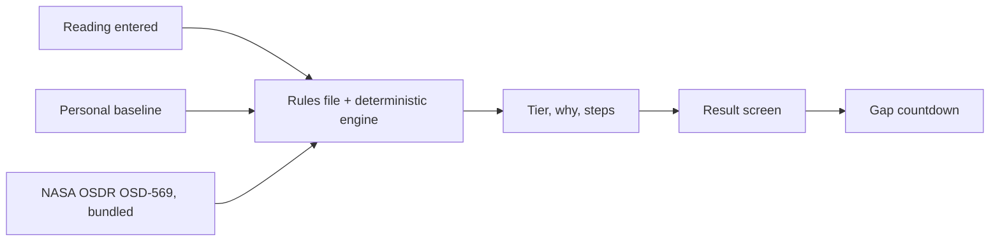

# Technical spec: astronaut health decision support (working title)

Version: v0.1 · Satisfies: docs/REQUIREMENTS.md v0.1 · Owner: Build lead

## 1. Architecture (satisfies: NFR-01, PR-01)
- Stack: a static single-page web app (Vite, React, TypeScript). No server, no accounts, no network calls on the demo path. Chosen because it deploys as plain files, works offline and suits a 48-hour build.
- Hosting: GitHub Pages from this public repo.
- Offline: a small service worker, written at build time, caches the built files; data and fonts are bundled.

## 2. Data (satisfies: DR-01, DR-02)
| Entity | Fields (name: type, unit) | Source dataset (name, ID, link) | Real / SYNTHETIC |
|--------|---------------------------|---------------------------------|------------------|
| Crew blood count | subject, analyte, value, unit, lab range, timepoint (days from launch or return) | NASA OSDR, OSD-569, https://osdr.nasa.gov/bio/repo/data/studies/OSD-569 | Real |
| Demo astronaut baseline | indicator, values, unit, dates | Made by us | SYNTHETIC |
| Demo astronaut readings | indicator, value, unit, time | Entered in the demo | SYNTHETIC |

## 3. Rules engine contract (satisfies: SR-01, FR-03, FR-04, FR-05)
- Rules live in `rules/rules.yaml`, not in code and not in a model prompt.
- Each rule: id, indicator, condition on the change from personal baseline, tier, why line, steps, source, confidence (High, Medium, Low), evidence grade, `signed_off_by` (a role, or `placeholder`).
- The loader rejects a rule with no source or no sign-off field. Placeholder rules render with a visible "Placeholder, awaiting clinician review" note and no review badge.
- No language model runs in the app. Explanations are the rule's own text with its values filled in.

## 4. Interfaces (satisfies: DR-01, FR-10)
| Interface | Request | Response | Mocked until |
|-----------|---------|----------|--------------|
| OSD-569 blood count | Fetched once at build time by a script | JSON bundled in the app | Never live in the demo |
| NASA DONKI events (Should) | Fetched once by a script | JSON bundled in the app | Never live in the demo |

## 5. UI screens (satisfies: FR-01 to FR-07, DR-01)
| Screen | User | Shows | Requirement IDs | Demo step |
|--------|------|-------|-----------------|-----------|
| Body figure (home) | Astronaut | Tappable regions with tier pills | FR-07 | 1 |
| Take a reading | Astronaut | Input with unit, why the check matters | FR-01, FR-08 | 1 |
| Result | Astronaut | Reading tile, baseline chart, tier pill, why, source, steps | FR-02, FR-03, FR-04, FR-05, DR-02 | 2, 3, 4 |
| Gap | Astronaut | Countdown to Earth's earliest reply, meanwhile steps | FR-06 | 4 |
| Real crew data | Astronaut, judge | OSD-569 crew baselines and return points through the same rule | DR-01 | 5 |

Look and voice follow the team design system: Cabin (dark) theme for the app, tier as colour plus shape plus word, cyan for actions, violet SYNTHETIC label, IBM Plex type self-hosted.

## 6. Fallbacks and offline (satisfies: NFR-01)
- No network: everything is bundled. Live demo fails: recorded screen capture.

## 7. Labelling, citation and units (satisfies: DR-02, PR-01)
- SYNTHETIC label: every data record has a `synthetic` flag; any card or chart drawing a flagged record renders the label.
- Units: one unit system per screen; units on every value.
- NASA data is credited in text by name and ID. No logos.

## 8. Risks
| Risk | Likelihood | Impact | Mitigation | Owner |
|------|------------|--------|------------|-------|
| Clinical values not signed off in time | Medium | High | Placeholders are visibly marked; unsigned rules are cut from the demo at hour 24 | Clinicians |
| OSD-569 read as in-flight data | Medium | High | On-screen wording says pre-flight and post-flight | Build lead |
| Stale cached build during the demo | Medium | Medium | Version stamp on screen; hard reload before recording | Build lead |
