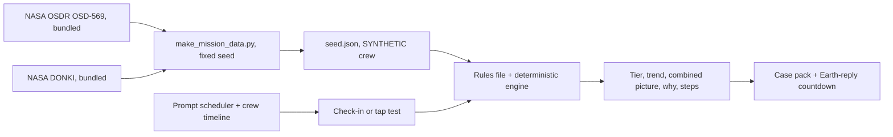

# Technical spec: astronaut health decision support (working title)

Version: v0.4 · Satisfies: docs/REQUIREMENTS.md v0.4 · Owner: Build lead

## 1. Architecture (satisfies: NFR-01, PR-01)
- Stack: a static single-page web app (Vite, React, TypeScript). No server, no accounts, no network calls on the demo path. Chosen because it deploys as plain files, works offline and suits a 48-hour build.
- Hosting: GitHub Pages from this public repo.
- Backend: none. The record lives on the device in IndexedDB (the database built into the browser), behind a small `Store` interface, so a shared store on a spacecraft network could replace it later.
- Action layer: `src/core/` holds pure functions (state in, new state out) for every read and change. The screens, the command-line tool (`cli/crew-health.ts`) and agents all call it. See docs/MODULE_GUIDE.md.
- Offline: a small service worker, written at build time, caches the built files; data and fonts are bundled.
- Data generator: `scripts/make_mission_data.py` writes `src/data/seed.json` with a fixed seed (satisfies FR-24).

## 2. Data (satisfies: DR-01, DR-02, FR-24)
| Entity | Fields (name: type, unit) | Source dataset (name, ID, link) | Real / SYNTHETIC |
|--------|---------------------------|---------------------------------|------------------|
| Crew blood count | subject, analyte, value, unit, lab range, timepoint (days from launch or return) | NASA OSDR, OSD-569, https://osdr.nasa.gov/bio/repo/data/studies/OSD-569 | Real |
| Crew profiles (`src/data/seed.json`) | crew id, name, sex (to pick the laboratory range), baseline series per indicator, mission series per indicator (86 days, with gaps for missed check-ins) | Made by us | SYNTHETIC |
| Today (`src/data/seed.json`) | crew 1's readings for day 87 | Made by us | SYNTHETIC |
| Indicators (`src/data/seed.json`) | id, name, unit, valid range, direction that matters (low, high or both), cadence, optional sourced limit, optional laboratory range by sex, hazards, explanation card (how, why, what, status, sources) | Haemoglobin variation and ranges: NASA OSDR, OSD-569. Carbon dioxide limit: NASA-STD-3001 Volume 2. Card wording: the team's challenge brief | Real inputs, draft wording |
| Environment profiles (`src/data/seed.json`) | id, label, reply delay in seconds, who answers, dominant risks, guidance line | Light-time arithmetic; wording written for the build | Delays arithmetic; remote Australia scenario SYNTHETIC |
| Crew timeline (`src/data/seed.json`) | start, end, label, critical flag; the slip in minutes | Made by us | SYNTHETIC |
| Privacy table (`src/data/seed.json`) | what, you, crew medic, flight surgeon, rest of crew | Team design choice | Draft policy |
| Device record (IndexedDB) | readings, check-ins, symptom logs, queued and exported cases | Entered on the device | SYNTHETIC in the demo |
| Solar particle events | time, instrument or model; radiation prompt days inside the mission window | NASA DONKI, https://ccmc.gsfc.nasa.gov/tools/DONKI/ | Real |

The demo mission is day 87. Each crew member has a pre-flight baseline (14 days; 3 draws for haemoglobin; the first two mission weeks for cabin carbon dioxide) and 86 mission days.

## 3. Rules engine contract (satisfies: SR-01, FR-03, FR-04, FR-05, FR-18)
- Rules live in `rules/rules.yaml`, not in code and not in a model prompt.
- Each rule: id, kind, indicator, tier, why line, steps, source, confidence (High, Medium, Low), evidence grade, `signed_off_by` (a role, or `placeholder`).
- The loader rejects a rule with no source or no sign-off field. Placeholder rules render with a visible "Placeholder, awaiting clinician review" note and no review badge.
- Each person's band is their own baseline mean plus or minus 2 standard deviations of their own baseline. For haemoglobin the standard deviation is the variation from OSD-569.
- The engine knows six rule kinds. All numbers are statistical conventions and placeholders until a clinician signs them (CR-02, CR-16).

| Kind | ID | Condition | Tier |
|------|----|-----------|------|
| Level | PB-01 | One reading outside the band | Amber, asks for a retest |
| Trend | TR-01 | The average of the last 7 readings has moved more than 1 standard deviation from baseline, in the direction that matters, even when every reading is inside the band | Amber |
| Sustained | SU-01 | 3 readings in a row outside the band | Red |
| Limit | LM-01 | Outside the band and beyond a sourced limit (NASA cabin carbon dioxide limit, or the laboratory range for haemoglobin) | Red |
| Combined | CM-01 | Two or more indicators flagged on the same day | Shown together as one picture |
| Prompt | PR-01 | A sleep trend or raised cabin carbon dioxide | Prompts a reaction-time check |

- Direction that matters: sleep low; mood low; reaction time high; cabin carbon dioxide high; resting heart rate and haemoglobin both (CR-14).
- Input checks refuse physically impossible readings before any rule runs (satisfies NFR-05).
- No language model runs in the app. Explanations are the rule's own text with its values filled in.
- The rules do not change by environment (CR-17).

## 4. Prompt scheduler (satisfies: FR-19)
- Input: the crew timeline for the day, the check-ins due and the current clock time.
- Never prompts during a critical operation (the demo EVA, 08:00 to 12:00). Check-ins due then are held and listed.
- Held check-ins move to the end of the operation. When a task runs late (the demo slips the EVA by 45 minutes), the end moves and the held check-ins move with it.
- Reaction time is prompted only when PR-01 fires. Cabin carbon dioxide is read from a sensor, which is SYNTHETIC in the demo.

## 5. On-device storage (satisfies: NFR-03)
- IndexedDB holds readings, check-ins, the streak, symptom logs and the case outbox. A reload with no network keeps them.
- The streak counts check-ins and never results. "Nothing to report" is a valid one-tap log. Insights unlock after 14 and 30 days of check-ins. The crew goal is a crew total with no ranking.
- The outbox queues cases and exports them as one file when a link opens (store and forward).

## 6. Interfaces (satisfies: DR-01, FR-10)
| Interface | Request | Response | Mocked until |
|-----------|---------|----------|--------------|
| OSD-569 blood count | Fetched once at build time by a script | JSON bundled in the app | Never live in the demo |
| NASA DONKI events | Fetched once by a script | JSON bundled in the app | Never live in the demo |
| Cabin carbon dioxide sensor | Not connected | SYNTHETIC series in the seed file | A real sensor connection is not built |

## 7. UI screens (satisfies: FR-01 to FR-07, FR-20 to FR-23, DR-01)
| Screen | User | Shows | Requirement IDs | Demo step |
|--------|------|-------|-----------------|-----------|
| Home (body figure and day) | Astronaut | Tappable regions for the six indicators with tier pills, the day's prompts, the streak and crew goal, the space-weather card | FR-07, FR-10, FR-19, FR-20 | 1 |
| Check-in | Astronaut | Input with unit, "Nothing to report", the 30-second tap test | FR-01, NFR-05 | 2, 4 |
| Result | Astronaut | Mission trend chart against own band, tier pill, trend and combined picture, why, source, steps | FR-02, FR-03, FR-04, FR-05, FR-18, DR-02 | 2, 3, 5 |
| Explanation card | Astronaut | How to measure, why it matters, what to do, hazard chips, sources, draft-wording note | FR-21 | 5 |
| Timeline | Astronaut | The crew day, the EVA, held check-ins, the slip | FR-19 | 1 |
| Gap | Astronaut | Case pack, countdown to Earth's earliest reply, meanwhile steps | FR-06, FR-09 | 6 |
| Environment switcher | Astronaut | Five profiles: delay, who answers, risks, guidance line | FR-22 | 7 |
| Who sees what | Astronaut | The privacy table, marked as a draft policy | FR-23 | not in demo |
| Real crew data | Astronaut, judge | OSD-569 crew baselines and return points through the same band rule | DR-01 | 7 |
| Road to flight | Judge | What is built, placeholder and needed | FR-17 | not in demo |

Look and voice follow the team design system: tier as colour plus shape plus word, SYNTHETIC label on every synthetic card and chart, IBM Plex type self-hosted.

## 8. Fallbacks and offline (satisfies: NFR-01)
- No network: everything is bundled. Live demo fails: recorded screen capture.

## 9. Labelling, citation and units (satisfies: DR-02, PR-01)
- SYNTHETIC label: the seed file carries a `synthetic` flag; any card or chart drawing a flagged record renders the label.
- Units: one unit system per screen; units on every value.
- NASA data is credited in text by name and ID. No logos. NASA does not endorse this project.

## 10. Risks
| Risk | Likelihood | Impact | Mitigation | Owner |
|------|------------|--------|------------|-------|
| Clinical values not signed off in time | Medium | High | Placeholders are visibly marked; unsigned rules are cut from the demo at hour 24 | Clinicians |
| OSD-569 read as in-flight data | Medium | High | On-screen wording says pre-flight and post-flight | Build lead |
| Carbon dioxide limit read as a clinical threshold | Medium | High | Evidence file and card state it is a habitat design requirement; using it as a prompt is the team's choice | Build lead |
| Stale cached build during the demo | Medium | Medium | Version stamp on screen; hard reload before recording | Build lead |
