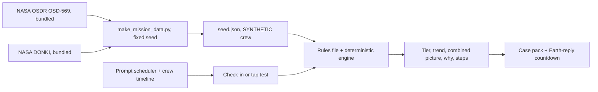

# Technical spec: astronaut health decision support (working title)

Version: v0.6 · Satisfies: docs/REQUIREMENTS.md v0.6 · Owner: Build lead

## 1. Architecture (satisfies: NFR-01, PR-01)
- Stack: a static single-page web app (Vite, React, TypeScript). No server, no accounts, no network calls on the demo path. Chosen because it deploys as plain files, works offline and suits a 48-hour build.
- Hosting: GitHub Pages from this public repo.
- Backend: none. The record lives on the device in IndexedDB (the database built into the browser), behind a small `Store` interface, so a shared store on a spacecraft network could replace it later.
- Action layer: `src/core/` holds pure functions (state in, new state out) for every read and change. The screens, the command-line tool (`cli/crew-health.ts`) and agents all call it. See docs/MODULE_GUIDE.md.
- Offline: a small service worker, written at build time, caches the built files; data and fonts are bundled.
- Data generator: `scripts/make_mission_data.py` writes `src/data/seed.json` with a fixed seed (satisfies FR-24).

## 2. Data (satisfies: DR-01, DR-02, FR-24)
| Entity | Fields (name: type, unit) | Source dataset (name, ID, link) | Real / SYNTHETIC |
|--------|---------------------------|---------------------------------|------------------|
| Crew blood count | subject, analyte, value, unit, lab range, timepoint (days from launch or return) | NASA OSDR, OSD-569, https://osdr.nasa.gov/bio/repo/data/studies/OSD-569 | Real |
| Crew profiles (`src/data/seed.json`) | crew id, name, sex (to pick the laboratory range), baseline series per indicator, mission series per indicator (213 days, with gaps for missed check-ins) | Made by us | SYNTHETIC |
| Today (`src/data/seed.json`) | crew 1's readings for day 214 | Made by us | SYNTHETIC |
| Indicators (`src/data/seed.json`) | id, group (body system), name, unit, valid range, input kind (number, scale, test, vision or sensor), direction that matters (low, high or both), cadence (daily, weekly, prompted or sensor), day of the mission week for weekly ones (`weekDay`), `mode: cumulative` for a running total, optional sourced limit (a fixed `high` or `low`, or `lowFraction` of the person's own baseline), optional laboratory range by sex, hazards, explanation card (how, why, what, status, sources), optional `cardNote` saying what the check is not | Haemoglobin variation and ranges: NASA OSDR, OSD-569. Carbon dioxide limit: NASA-STD-3001 Volume 2. Strength floor and career radiation limit: NASA-STD-3001 Volume 1. Card wording: the team's challenge brief | Real inputs, draft wording |
| Environment profiles (`src/data/seed.json`) | id (`mars-base`, `transit`, `moon`, `station`, `earth`), label, reply delay in seconds, countdown wording, dominant risks, guidance line, word swaps for Remote Australia | Light-time arithmetic; wording written for the build | Delays arithmetic; remote Australia scenario SYNTHETIC |
| Crew timeline (`src/data/seed.json`) | start, end, label, critical flag; the slip in minutes | Made by us | SYNTHETIC |
| Privacy table (`src/data/seed.json`) | what, you, crew medic, flight surgeon, rest of crew | Team design choice | Draft policy |
| Device record (IndexedDB) | readings (with tier, rules fired and steps ticked), symptom logs, "Nothing to report" logs, queued and exported cases, and screen choices (crew member, place, theme, clock, slip, dosimeter tick) | Entered on the device | SYNTHETIC in the demo |
| Solar particle events | time, instrument or model; the mission days with an event, listed in the seed file as radiation prompt days | NASA DONKI, https://ccmc.gsfc.nasa.gov/tools/DONKI/ | Real |

The demo mission is day 214. There are fifteen indicators in seven groups, in this order: Mind and sleep (sleep, mood, reaction time); Heart (resting heart rate, blood pressure upper and lower); Eyes (near vision); Muscle and bone (exercise plan done, grip strength, body mass); Food and fluid (fluid intake, food energy); Blood (haemoglobin); Cabin and radiation (cabin carbon dioxide, radiation dose).

Each crew member has a pre-flight baseline and 213 past mission days. Baselines are 14 days for the daily indicators and reaction time; 4 readings for blood pressure, grip strength and body mass; 4 near-vision results; 3 draws for haemoglobin; the first two mission weeks for cabin carbon dioxide; none for radiation dose, which is a running total. Weekly indicators have a mission value only on their own day of the mission week. Today's demo values for Jo are sleep 6.2 h, resting heart rate 59 bpm, mood 3, reaction time 318 ms, cabin carbon dioxide 3.4 mmHg, haemoglobin 13.1 g/dL, near vision 7 lines, exercise plan done 90%, fluid intake 2.3 L, food energy 2300 kcal, blood pressure 113 over 71 mmHg, grip strength 30.6 kg and body mass 61.7 kg. The demo radiation value is the last mission total plus 0.7 mSv.

## 3. Rules engine contract (satisfies: SR-01, FR-03, FR-04, FR-05, FR-18, FR-26)
- Rules live in `rules/rules.yaml`, not in code and not in a model prompt.
- Each rule: id, kind, tier, why line, source, confidence (High, Medium, Low) and `signed_off_by` (a role, or `placeholder`), plus its numbers (`count` for sustained; `window` and `shift_sd` for trend). Rules apply to every indicator. Next steps are set per tier, not per rule; an indicator can carry its own steps instead (cabin carbon dioxide does).
- The loader rejects a rule with no source, no sign-off field or no confidence label, and a tier with no next steps. Placeholder rules render with a visible "Placeholder rule, awaiting clinician review" note and no review badge.
- Each person's band is their own baseline mean plus or minus k standard deviations of their own baseline, with k = 2 (`band.k`). For haemoglobin the standard deviation is the variation from OSD-569 (0.601 g/dL).
- The engine knows six rule kinds. All numbers are statistical conventions and placeholders until a clinician signs them (CR-02, CR-16).

| Kind | ID | Condition | Tier |
|------|----|-----------|------|
| Level | PB-01 | One reading outside the band, on the side that matters | Amber. Not shown when a red rule also fires |
| Trend | TR-01 | The average of the last 7 readings (`window: 7`) has moved more than 1 standard deviation (`shift_sd: 1`) from the baseline mean, in the direction that matters, even when every reading is inside the band | Amber |
| Sustained | SU-01 | The last 3 readings (`count: 3`), including today's, all outside the band on the same side | Red |
| Limit | LM-01 | Outside the band and beyond a sourced limit (NASA cabin carbon dioxide limit; the NASA strength floor for grip strength, 80% of the person's own baseline mean; or the laboratory range for haemoglobin). Also a running total over its limit (radiation dose over 600 mSv) | Red |
| Combined | CM-01 | Two or more indicators flagged on the same day (`min_flags: 2`) | One card listing them; it takes the highest tier among them and does not change any single result |
| Prompt | PR-01 | Sleep or cabin carbon dioxide flagged today (any amber or red result) | No tier. Asks for a reaction-time check today |

- Direction that matters: low for sleep, mood, near vision, exercise plan done, grip strength, body mass, fluid intake and food energy; high for reaction time, cabin carbon dioxide and radiation dose; both for resting heart rate, blood pressure upper and lower, and haemoglobin (CR-14).
- `limitsFor` works out the sourced limits for one person and one indicator: a fixed limit from the indicator, a floor of `lowFraction` times the person's own baseline mean (grip strength: 0.8), or the laboratory range for their sex (haemoglobin).
- A running total (`mode: cumulative`, radiation dose) is judged against its limit, not a personal band. Over the limit is red (LM-01); otherwise green, with the total shown as a share of the limit. A total lower than the last reading is refused with a plain message. Dose from earlier flights is not counted. No tier below the limit is set (CR-22).
- When more than one rule fires, the result takes the highest tier and lists every rule that fired (for example "LM-01 + SU-01 + TR-01").
- A raised result is marked confirmed when the reading before it today was also outside the band.
- Input checks refuse impossible readings before any rule runs, using each indicator's input range (for example sleep 0 to 24 h, resting heart rate 20 to 250 bpm) (satisfies NFR-05).
- No language model runs in the app. Explanations are the rule's own text with its values filled in.
- The rules do not change by environment (CR-17).

## 4. Prompt scheduler (satisfies: FR-19)
- Input: the crew timeline for the day, the check-ins due and the current clock time.
- Morning check-ins are offered 15 minutes after the day starts (06:45); evening check-ins 10 minutes after the last block starts (21:10). The demo clock can be set to 06:45, 09:30, 12:10 or 21:10.
- Never prompts during a critical operation (the demo EVA, 08:00 to 12:00). Check-ins due then are held and listed, moved to five minutes after the operation ends (12:05).
- When a task runs late (the demo slips the EVA by 45 minutes), the EVA ends at 12:45, every later block moves 45 minutes, and the held check-ins move to 12:50.
- Six check-ins are due daily: sleep, resting heart rate, mood, exercise plan done, fluid intake and food energy. Each weekly check-in falls due when the mission day modulo 7 equals its `weekDay`: haemoglobin 1, blood pressure 2, near vision 4, grip strength and body mass 6. On day 214 that is near vision. Reaction time is due only when PR-01 fires. Cabin carbon dioxide and radiation dose are read from sensors, which are SYNTHETIC in the demo, and are not scheduled.

## 5. On-device storage (satisfies: NFR-03)
- Habitat readings: an indicator marked `environment` (cabin carbon dioxide) is worded as the cabin's one-hour average against the cabin's usual range. The same rules apply; only the wording changes, and the result says it is an environment alert first.
- Times on screen are mission time: the chosen mission clock, running forward from when it was set. Exported cases keep real timestamps.
- Symptom pathways (`pathways:` in `rules/rules.yaml`, code in `src/core/pathways.ts`): core symptoms open follow-up questions; core plus a supporting symptom is Crew medic; an urgent symptom on top is Urgent. A pathway case holds symptoms, pain scores, recent trends, other signals and ticked steps. The first pathway is a possible kidney stone (KS-01); it names a pattern to check, never a finding.
- IndexedDB (database `crew-health`) holds one record: readings, symptom logs, "Nothing to report" logs, the case outbox and screen choices. It is saved after every action, and a reload with no network keeps it. If the browser blocks IndexedDB, the app keeps the record in memory.
- The streak is worked out, not stored: the days in a row with every daily check-in (the six above) logged, counting today once all six are logged. It counts check-ins and never results. "Nothing to report" is a valid one-tap log. Insights unlock at 14 and 30 days of streak.
- The crew goal is the whole crew's daily check-ins over the past seven days (six past days and today) against the total possible. No one is ranked.
- The outbox queues one case per reading and exports queued cases as one JSON file (format `crew-health-case-export/3`) when a link opens (store and forward). Each case includes the reading, the past 14 days, the rules that fired, the steps given and ticked, symptoms and the other signals flagged that day.

## 6. Interfaces (satisfies: DR-01, FR-10)
| Interface | Request | Response | Mocked until |
|-----------|---------|----------|--------------|
| OSD-569 blood count | Fetched once by a script (`scripts/fetch_osd569.py`) | JSON bundled in the app | Never live in the demo |
| NASA DONKI events | Fetched once by a script (`scripts/fetch_donki.py`) | JSON bundled in the app | Never live in the demo |
| Cabin carbon dioxide sensor | Not connected | SYNTHETIC series in the seed file | A real sensor connection is not built |
| Personal dosimeter | Not connected | SYNTHETIC running total in the seed file | A real device connection is not built |

## 7. UI screens (satisfies: FR-01 to FR-07, FR-20 to FR-23, FR-25, FR-26, DR-01)
| Screen | User | Shows | Requirement IDs | Demo step |
|--------|------|-------|-----------------|-----------|
| Today (home) | Astronaut | Who and where, the combined card, the reaction-test prompt, the day's check-ins on the timeline, a body figure with five areas (Mind and sleep, Eyes, Heart, Blood, Muscle and bone), each showing the most serious result in its group today, and a list of all fifteen signals grouped by body system with tier pills, the streak and crew goal, "Feeling off?" with "Nothing to report", the space-weather card | FR-07, FR-10, FR-11, FR-19, FR-20 | 1 |
| Reading (check-in) | Astronaut | Input with unit, scale, tap test or near-vision self-check, the demo value, the person's baseline (or, for a running total, its limit), any sourced limit with its source, and the explanation card with any note on what the check is not | FR-01, FR-21, FR-25, FR-26, NFR-05 | 2, 4 |
| Result | Astronaut | Past four weeks against own band, tier pill, why, source, rules that fired, steps, confirmation, other signals flagged today. For radiation dose: a bar showing the total as a share of the career limit instead of the band chart | FR-02, FR-03, FR-04, FR-05, FR-18, FR-26, DR-02 | 2, 3, 5 |
| Explanation card (on the reading screen) | Astronaut | How to measure, why it matters, what to do, hazard chips, sources, draft-wording note | FR-21 | 5 |
| Timeline (on Today) | Astronaut | The crew day, the EVA, held check-ins, the slip | FR-19 | 1 |
| Gap | Astronaut | Case pack, countdown to Earth's earliest reply, meanwhile steps, place switcher | FR-06, FR-09, FR-22 | 6 |
| Environment switcher (on Today and Gap) | Astronaut | Five profiles: delay, who answers, risks, guidance line | FR-22 | 7 |
| Outbox | Astronaut | Queued and exported cases; export as one file | FR-15 | 6 |
| Real crew data | Astronaut, judge | OSD-569 crew baselines and return points through the same band rule | DR-01 | 7 |
| Privacy and limits | Astronaut, judge | The "Who sees what" table (draft policy); what is built, placeholder and needed | FR-17, FR-23 | not in demo |

Look and voice follow the team design system: tier as colour plus shape plus word, SYNTHETIC label on every synthetic card and chart, IBM Plex type self-hosted.

## 8. Fallbacks and offline (satisfies: NFR-01)
- No network: everything is bundled. Live demo fails: recorded screen capture.

## 9. Labelling, citation and units (satisfies: DR-02, PR-01)
- SYNTHETIC label: the seed file carries a `synthetic` flag; any card or chart drawing a flagged record renders the label.
- Units: one unit system per screen; units on every value.
- NASA data is credited in text by name and ID. No logos. NASA does not endorse this project.

## 10. Risks
| Risk | Likelihood | Impact | Mitigation | Owner |
|------|------------|--------|------------|-------|
| Clinical values not signed off in time | Medium | High | Placeholders are visibly marked; unsigned rules are cut from the demo at hour 24 | Clinicians |
| OSD-569 read as in-flight data | Medium | High | On-screen wording says pre-flight and post-flight | Build lead |
| Near-vision self-check read as an eye test | Medium | High | The reading screen and the card say it is not a calibrated eye chart and not a test for any eye condition | Build lead |
| Strength floor or career radiation limit read as a clinical threshold | Medium | Medium | The evidence file states both are programme requirements in NASA-STD-3001 Volume 1; using them as prompts is the team's choice | Build lead |
| Carbon dioxide limit read as a clinical threshold | Medium | High | Evidence file and card state it is a habitat design requirement; using it as a prompt is the team's choice | Build lead |
| Stale cached build during the demo | Medium | Medium | Hard reload before recording; the service worker cache name changes with every build | Build lead |
